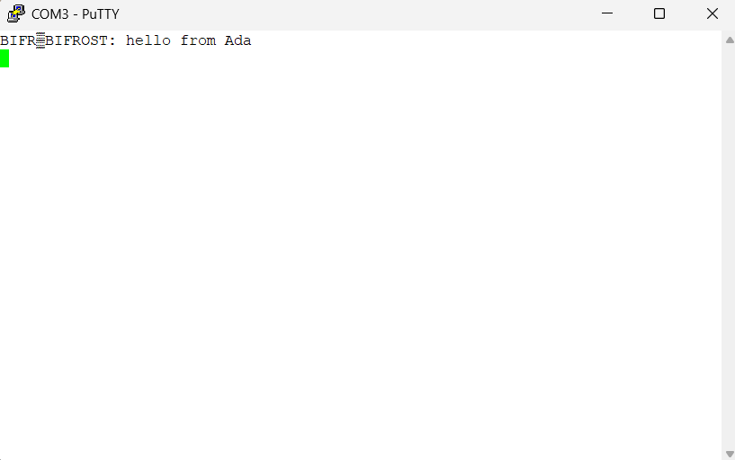

<!--
-- ============================================================================
-- This file is part of Bifrost
--
-- Copyright (c) 2025 Jeff Wandling
-- All Rights Reserved.
--
-- Licensed under BSD 3-Clause
-- Redistribution and use in source and binary forms, with or without
-- modification, are permitted under the terms of the BSD 3-Clause license.
-- See the LICENSE file for the full text.
-- ============================================================================
-->
# Ada


This directory holds two independent, from-scratch Ada ports of the C
applications living alongside them in [`../c/`](../c/). See
[`../README.md`](../README.md) for how the two language trees relate,
and [`../HARDWARE.md`](../HARDWARE.md) for the boards.

<i>Note: this page assumes your toolchain is already set up. If not, see
[`SETUP.md`](SETUP.md) first -- it covers the one-time install steps,
shared by both projects below. There is also a
[Software Design Document](SOFTWARE.md) here that explains the
architecture of both.</i>

## Three ports, three boards

|  | [`f722ze-tiny`](#f722ze-tiny-nucleo-f722ze) | [`f767zi`](#f767zi-nucleo-f767zi) | [`samv71-tiny`](#samv71-tiny-samv71-xplained-ultra) |
|---|---|---|---|
| Board | NUCLEO-F722ZE (STM32F722ZET6) | NUCLEO-F767ZI (STM32F767ZI) | SAMV71 Xplained Ultra (ATSAMV71Q21B) |
| Internal name | `Bifrost` (`bifrost.gpr`) | `Bifrost` (`bifrost.gpr`) | `Samv71_Tiny` (`samv71_tiny.gpr`) |
| GNAT runtime | `light-cortex-m7f` -- generic, non-tasking | `light-tasking-stm32f769disco` -- board-specific Ravenscar BSP (F769NI-targeted, memory-map-identical to F767ZI -- see `../HARDWARE.md`) | `light-tasking-samv71` -- real board-specific Ravenscar BSP |
| Tasking | none available for this board at all | real: protected objects, two library-level tasks (`LCD_Sink`, `UART_Sink`) | real: protected objects, a library-level console `task` |
| Interrupt-driven I/O | yes, but hand-rolled (extended vector table + plain ISR procedure + lock-free ring buffers) | yes, idiomatic Ravenscar (`pragma Attach_Handler`, protected entries) | yes, idiomatic Ravenscar (`pragma Attach_Handler`, protected entries) |
| Vector table / startup | hand-written (`Bifrost.Startup`) -- no board BSP exists | supplied by the runtime's own `start-rom.S` -- nothing to hand-write | supplied by the runtime's own `start-rom.S` -- nothing to hand-write |
| Debug probe | ST-Link (OpenOCD) | ST-Link (OpenOCD) | SEGGER J-Link |
| Status | LCD counter demo + TinyMon console, no tasking (this is the tree that stays that way -- see `f767zi` for the tasking phase) | LCD counter demo + TinyMon console with real Main/`LCD_Sink`/`UART_Sink` tasking (`../SOFTWARE.md`); compiles and binds clean against the real toolchain, not yet run on actual hardware | all 6 planned phases complete and verified |

The short version: `f722ze-tiny` is what this Ada effort started on, and
it's a real, working bare-metal Ada program -- but the board itself has
no Ravenscar tasking support at all in the installed toolchain, so
everything on it (including its interrupt-driven UART) is built the
hard way, without language-level concurrency, and it stays that way --
it is not getting a tasking phase of its own. `f767zi` is that tasking
phase, as its own top-level tree rather than a board variant of
`f722ze-tiny` (same reasoning `samv71-tiny` is its own tree): once a
real Ravenscar runtime is involved, the architecture differs in kind,
not just in register addresses. `samv71-tiny` is a separate, earlier Ada
port on unrelated silicon, included here because the SAMV71 Xplained
Ultra's own board-specific Ravenscar BSP let it demonstrate the same
*kind* of interrupt-driven-tasking architecture well before an
F767ZI was in hand to build `f767zi` against.

# f722ze-tiny (NUCLEO-F722ZE)

This is the Ada implementation of `bifrost`, the bare-metal firmware
application for the NUCLEO-F722ZE -- internally still named `Bifrost`
(package root, `bifrost.gpr`, executable `bifrost.elf`); only the
top-level directory was renamed to `f722ze-tiny` for consistency with
`samv71-tiny`'s board-app naming.

## Status

This port now has the full bare-metal startup chain (vector table,
Reset Handler, `.data`/`.bss` init, GNAT elaboration), the LCD counter
demo ported from the C side, and an interrupt-driven, bidirectional
USART3 driver (`Bifrost.UART`) carrying a TinyMon console
(`Bifrost.TinyMon`, `help`/`count` commands) -- both running from the
same non-tasking main loop (no Ravenscar runtime exists for this
board; see [`../HARDWARE.md`](../HARDWARE.md)), with the console polled
non-blockingly each iteration alongside the LCD update. The ohmmeter
calculation/client logic in `behavioral/` has not been ported
(`behavioral/calc/` and `behavioral/client/` exist as empty
placeholders) -- this is still a proof-of-life-plus-console stage, not
the full application.

## Target Hardware

**NUCLEO-F767ZI is the preferred board for this Ada port.** Unlike the
C target, board choice is not incidental here: the installed GNAT
toolchain's Ravenscar/tasking runtime support (`light-tasking-*`) is
only packaged for specific named boards, and F767ZI is the one that
actually matches hardware that's available to buy -- see
[`../HARDWARE.md`](../HARDWARE.md) for the full rationale, including
why F722ZE (the board this repo originally targeted) isn't a fit for
Ada going forward once tasking is involved.

The work so far (UART proof-of-life, LCD counter demo -- see "Status"
above) was built and proven on an actual F722ZE, using the generic,
non-tasking `light-cortex-m7f` runtime, which doesn't care which board
it's on. That part of the port is not being redone; it's simply not
where new Ada work on this project is headed. The tasking phase targets
F767ZI once that board is in hand -- no source changes for it exist
yet.

## Build

Toolchain prerequisites: see [`SETUP.md`](SETUP.md).

From `f722ze-tiny/`:

```
$ cd f722ze-tiny
$ bash buildw.sh
```

This invokes `gprbuild` against `bifrost.gpr`, cross-compiling for
`arm-eabi` with the `light-cortex-m7f` runtime, producing
`bin/bifrost.elf`. Note that `gprbuild`'s default output naming follows
the `Main` source file's base name (`main`), not the project name --
`bifrost.gpr` explicitly renames it via its `Builder` package so the
output matches the C side's `bifrost.elf`.

## Debugging with GDB

This project reuses `setupw.sh` from the C side -- byte-identical,
copied over unmodified, since it's a fully generic OpenOCD/gdb wrapper
that has no idea what language produced the ELF it's pointed at. Two
windows, two modes:

In one `git-sdk-64` window, start the GDB server (this is the one that
talks SWD to the ST-Link):

```
$ bash setupw.sh -s
```

In a second `git-sdk-64` window, start the GDB client, pointed at the
built image:

```
$ bash setupw.sh -d -i bin/bifrost.elf
```

Internally, that second command is just a thin wrapper around:

```
$ arm-none-eabi-gdb -q bin/bifrost.elf -ex "target extended-remote :2331"
```

Note: this is the **same gdb** the C side uses (`arm-none-eabi-gdb`, from
the ARM GNU toolchain), not a separate Ada-specific debugger. GNAT emits
standard DWARF debug info, so everything below works exactly as it does
on the C side -- the command reference is reproduced here in full since
it's worth having self-contained on each side, even though the commands
themselves don't change.

<ul>
<li> <b>list</b> will print the lines of source code at the current
context of the software.  As long as <b>-g</b> flag is given to the
compiler, the debug symbols will be present in the image.
<li> Pressing <b>Enter</b> in <b>gdb</b> simply repeats the last command.
<li> <b>b</b> sets a breakpoint.   There are a number of ways to set break points:
  <ol>
   <li> The line number of the current compilation unit (otherwise known as
  the current module, otherwise known as the file that is in context.)
   <li> The function (or, in Ada, procedure/subprogram) name <b>b name</b>
    where <b>name</b> is a subprogram name in the software.  <b>gdb</b> has
    tab-completion so you can search interactively.
   <li> The line number of a compilation unit (file) that is *not in the
  current context* by <b>b filename:linenumber</b>  OR by subprogram name in
  that module by <b>b filename::subprogram</b>.
   <li> The address to break.  This is useful if you're trying to stop, step
  at a certain machine instruction.  <b>b &#42;ADDRESS</b>. If the address was <b>0x2001002</b> then use <b>b &#42;0x2001002</b>.
   <li> To show the next 10 instructions: <b>x/10i $pc</b>
   <li> There are more commands to investigate and print out the assembly
of the image loaded.  Most of the time we're going to debug line by line (of source), but you can also debug at the instruction granularity. See the <b>gdb</b> manual for all of those commands
   </ol>
<li> <b>load</b>  Reads the image file argument and attempts to write it into
the  memory sections defined in the linker file (<b>.ld</b>) for the application.

It reads the ELF file headers (section table + program headers) to know:
For each section (.text, .data, .rodata, etc.),
The Load Memory Address (LMA) - i.e. where in target memory it should go.
Those addresses are fixed by your linker script (.ld) -- the exact same
`config/stm32f722ze.ld` used on the C side, unchanged, since the linker
itself does not care what compiler produced the object files it's
placing.
<pre>
<code>
MEMORY {
  FLASH (rx)  : ORIGIN = 0x08000000, LENGTH = 512K
  RAM   (rwx) : ORIGIN = 0x20000000, LENGTH = 256K
}

.text : { &#42;(.text&#42;) } > FLASH
.data : { &#42;(.data&#42;) } > RAM AT > FLASH
.bss  : { &#42;(.bss&#42;)  } > RAM
.text and .rodata get LMA = 0x08000000 + ... (in Flash).
</code>
</pre>

<b>.data</b> has VMA = RAM (<b>0x2000xxxx</b>), but LMA = Flash (<b>0x0800yyyy</b>).

At load time, GDB writes .text into Flash, and .data's init image into Flash at <b>0x0800yyyy</b>. In this port, `Bifrost.Startup.Reset_Handler`
(`lowlevel/src/bifrost-startup.adb`) is the pure-Ada code that performs
this exact Flash-to-RAM copy for `.data` and the `.bss` zero-fill, at
runtime, before anything else executes -- `load` is what gets the
*initial* `.data` image into Flash in the first place; `Reset_Handler`
is what moves it into RAM on every reset thereafter.

<li> <b>c</b>  (Continue) -- the debugger will cause the software to run freely until either a breakpoint is reached or a fault/trap occurs, or some other
error.  If the flow of execution has completed, then this also is a cause for
<b>c</b> to stop progress.  But in embedded systems, it's highly unusual
for the software to reach a point where no more execution occurs in the
nominal path.  Embedded software usually runs continually.
<pre>
<code>
procedure Main is
begin
   -- ...
   loop
      -- ...
      Work;
   end loop;

   -- never reaches here
end Main;
</code>
</pre>

<li> <b>q</b> quits the debugger.
</ul>

### A Sample Debugging Session

What follows is a real, unedited debugging session against the Ada build,
captured straight off the terminal. User input is **bold**; everything
else is `gdb`/target output. This is a particularly good session to read
closely, because it walks straight through the GNAT-generated `main` ->
`adainit` -> `Ada_Main_Program` -> user `Main` chain described in
[SOFTWARE.md's "Requirements" section](SOFTWARE.md#requirements) --
proof, on real hardware, that the elaboration model described there in
the abstract is exactly what actually executes.

(Captured before the LCD counter demo and TinyMon console existed, back
when `Main` was just a UART hello-world loop -- kept as-is, not
re-captured, since it's a real transcript and the elaboration chain it
demonstrates hasn't changed. The specific lines it steps through
(`Bifrost.UART.Initialize;` then `Put_Line ("BIFROST: hello from
Ada")`) no longer match current `main.adb`.)

The client was started against an already-running target, so gdb's
first stop is wherever the CPU happened to be executing -- in this case,
mid-loop, inside the `Delay_Ms` busy-wait:

```
$ bash setupw.sh -d -i bin/bifrost.elf
Using image bin/bifrost.elf
Reading symbols from bin/bifrost.elf...
Remote debugging using :2331
bifrost.delay_util.delay_cycles (count=3828000)
    at C:\Users\jdw\radiojeff\bifav\ada\bifrost\lowlevel\src\bifrost-delay_util.adb:20
20            while N > 0 loop
(gdb) **load**
Loading section .data.bifrost__delay_util_E, size 0x2 lma 0x20000000
Loading section .data.bifrost__startup_E, size 0x2 lma 0x20000002
Loading section .data.bifrost__uart_E, size 0x2 lma 0x20000004
Loading section .data.system__text_io__initialized, size 0x1 lma 0x20000006
Loading section .data.system__semihosting__buffer_index, size 0x2 lma 0x20000008
Loading section .isr_vector, size 0x40 lma 0x8000000
Loading section .text, size 0xe8 lma 0x8000040
Loading section .text.adainit, size 0x44 lma 0x8000128
Loading section .text.main, size 0x20 lma 0x800016c
Loading section .text.bifrost__delay_util__delay_cycles, size 0x38 lma 0x800018c
Loading section .text.bifrost__delay_util__delay_ms, size 0x44 lma 0x80001c4
Loading section .text.Default_Handler, size 0x8 lma 0x8000208
Loading section .text.bifrost__startup__copy_region, size 0x5c lma 0x8000210
Loading section .text.bifrost__startup__zero_region, size 0x40 lma 0x800026c
Loading section .text.Reset_Handler, size 0x38 lma 0x80002ac
Loading section .text.bifrost__uart__initialize, size 0x68 lma 0x80002e4
Loading section .text.bifrost__uart__put, size 0x34 lma 0x800034c
Loading section .text.bifrost__uart__put_line, size 0x78 lma 0x8000380
Loading section .text._ada_main, size 0x28 lma 0x80003f8
Loading section .text.ada__exceptions__last_chance_handler__put.0, size 0x20 lma 0x8000420
--Type <RET> for more, q to quit, c to continue without paging--
Loading section .text.__gnat_last_chance_handler, size 0x6c lma 0x8000440
Loading section .text.gnat__io__put__2, size 0x44 lma 0x80004ac
Loading section .text.gnat__io__new_line, size 0x18 lma 0x80004f0
Loading section .text.gnat__io__put, size 0x84 lma 0x8000508
Loading section .text.gnat__io__put__3, size 0x20 lma 0x800058c
Loading section .text.gnat__io__put_line, size 0x28 lma 0x80005ac
Loading section .text._exit, size 0x18 lma 0x80005d4
Loading section .text.__gnat_stop, size 0x8 lma 0x80005ec
Loading section .text.system__text_io__initialize, size 0xc lma 0x80005f4
Loading section .text.system__text_io__is_tx_ready, size 0x4 lma 0x8000600
Loading section .text.system__text_io__put, size 0x4 lma 0x8000604
Loading section .text.system__text_io__use_cr_lf_for_new_line, size 0x4 lma 0x8000608
Loading section .text.system__semihosting__put, size 0x90 lma 0x800060c
Start address 0x080002ac, load size 1701
Transfer rate: 1 KB/sec, 51 bytes/write.
(gdb) **b Main**
Breakpoint 1 at 0x8000172: Main. (2 locations)
Note: automatically using hardware breakpoints for read-only addresses.
(gdb) **r**
The program being debugged has been started already.
Start it from the beginning? (y or n) y
Starting program: C:\Users\jdw\radiojeff\bifav\ada\bifrost\bin\bifrost.elf

Breakpoint 1, main () at b__main.adb:27
27            Ensure_Reference : aliased System.Address := Ada_Main_Program_Name'Address;
(gdb) **n**
halted: PC: 0x08000174
halted: PC: 0x08000176
31            adainit;
(gdb)
halted: PC: 0x08000128
32            Ada_Main_Program;
(gdb)
halted: PC: 0x080003f8

Breakpoint 1, main ()
    at C:\Users\jdw\radiojeff\bifav\ada\bifrost\app\src\main.adb:31
31         Bifrost.UART.Initialize;
(gdb)
halted: PC: 0x080002e4
33            Bifrost.UART.Put_Line ("BIFROST: hello from Ada");
(gdb)
halted: PC: 0x08000402
halted: PC: 0x08000404
halted: PC: 0x08000406
halted: PC: 0x08000408
halted: PC: 0x08000380
34            Bifrost.Delay_Util.Delay_Ms (500);
(gdb)
```

A few things worth calling out, since this is the clearest possible
confirmation of the architecture described in SOFTWARE.md:

- `load` lists every compiled unit by its mangled Ada name
  (`bifrost__uart__put_line`, `bifrost__startup__copy_region`, and so
  on) -- this is the `with`-dependency closure in action: everything
  listed here is everything GNAT decided was reachable from `Main`
  and therefore worth linking in, `Bifrost.Startup` included.
- `b Main` reports **2 locations** -- this is not a mistake or a
  duplicate symbol bug. One location is the breakpoint on the user's
  `procedure Main` in `app/src/main.adb`; the other is inside the
  binder-generated `b__main.adb`'s own `main ()`, which (confusingly,
  but correctly) *also* has a reference named `Main` in scope via the
  `Ada_Main_Program_Name` plumbing. gdb is honoring both.
- `r` stops first inside `b__main.adb` -- this is the GNAT-generated
  `main` symbol from SOFTWARE.md's "Requirements" section, caught
  before it has done anything yet (line 27 is just a local
  `aliased System.Address` declaration).
- Stepping (`n`) through shows `adainit;` executing (Ada package
  elaboration, called out explicitly in SOFTWARE.md as the binder's
  responsibility) immediately followed by `Ada_Main_Program;` -- the
  binder's call into the user's actual `Main` procedure.
- The *second* hit of "Breakpoint 1" is the real one -- now reporting
  `app/src/main.adb:31`, the user's own `Bifrost.UART.Initialize;`
  line. This is the moment control has fully passed from
  binder-generated glue into application code.
- From there the session steps straight through `Put_Line` and into
  `Delay_Ms (500)`, the exact body of the super-loop in `main.adb`.

### Proof of Life



(Same vintage as the debugging session above -- captured when `Main`
was a UART hello-world loop, before the LCD counter demo and TinyMon
console existed. Kept as a real artifact of that stage, not
re-captured.)

A PuTTY session on COM3 (115200-8-N-1, the ST-Link VCP) showing the live
output of the loop in `main.adb`:
`Bifrost.UART.Put_Line ("BIFROST: hello from Ada");` repeating every
500ms via `Bifrost.Delay_Util.Delay_Ms (500)`. The overlapping
characters visible at the start of the line are the terminal's cursor
redrawing over the prior line at the instant the screenshot was taken,
mid-transmission of a subsequent iteration -- not corrupted UART data;
each full line read on its own is clean. This is the Ada port's
end-to-end proof of life: built with `gprbuild`, flashed and executed
via the pure-Ada `Reset_Handler`/vector table in
`lowlevel/src/bifrost-startup.adb`, running through the GNAT-generated
`main`/`adainit` chain documented above, and transmitting real
characters out the hand-rolled `Bifrost.UART` driver.

# f767zi (NUCLEO-F767ZI)

This is the tasking-phase Ada port of `bifrost` -- the Main/`LCD_Sink`/
`UART_Sink` architecture `../SOFTWARE.md` planned and `f722ze-tiny`
above was blocked on (see `../HARDWARE.md`). Same internal identity as
`f722ze-tiny` (`Bifrost`, `bifrost.gpr`, `bifrost.elf`) -- this is a
different top-level directory for the same application, not a
different one, same relationship as `f722ze-tiny`'s own directory
rename from the C tree's naming.

## Status

Running on real hardware: `Main` reaches `Bifrost.UART.Initialize`
(confirmed by reading `USART3.CR1` directly over SWD, not by trusting
any single tool), and the TinyMon welcome banner/prompt is confirmed
printing over the console. LCD pin assignments are still carried
forward unverified from `f722ze-tiny`'s board file (no physical display
has been wired to this board yet).

Getting to that point surfaced two real, now-fixed hardware/toolchain
issues, both worth knowing if this is ever rebuilt from scratch:

1. **HSE needs bypass mode.** This board's HSE (until a real crystal is
   populated at X3) is the ST-LINK's own actively-driven MCO output, not
   a passive crystal -- but the stock runtime's `Setup_Pll` assumes a
   passive crystal (`HSE_Bypass => False`). Left that way, the PLL
   reports `HSERDY`/`PLLRDY` success the whole time, while the actual
   achieved clock empirically locks at very close to 1/3 of the intended
   frequency -- confirmed two independent ways on real hardware: UART
   needing a terminal at 38400 instead of the computed ~115200, and
   `Ada.Real_Time` ticking at 1/3 rate over a real, stopwatch-timed
   30-second interval. Fixed via a second `gnat_user` override (see
   `runtime-overrides/README.md`) setting `HSE_Bypass => True`. With that
   fix in, the UART baud divisor should be re-verified at the originally
   computed ~115200 rather than assumed still-correct at 38400.
2. **gdb's `load` can silently not write anything to flash.** If the
   `arm-eabi-gdb` bundled with the GNAT-FSF archive gets picked up ahead
   of the official ARM GNU Toolchain's `arm-none-eabi-gdb` (a PATH-order
   accident, not a deliberate choice), it lacks libexpat/XML support --
   visible as "Can not parse XML target description/memory map" at every
   connect. That's not cosmetic: `load` needs the XML memory map to know
   an address range is flash and route the write through OpenOCD's real
   flash-programming algorithm; without it, `load` sends plain memory
   writes that silently have no effect on actual flash content, while
   still printing normal-looking "Loading section..." success output.
   `setupw.sh` now prefers `arm-none-eabi-gdb` for this reason. If `load`
   ever looks successful but a fresh `mdw 0x08000000` (via OpenOCD's
   telnet console, port 4444) still reads `ffffffff`, flash with
   OpenOCD's own `program bin/bifrost.elf verify reset` command instead
   of gdb's `load`.

## Target Hardware

NUCLEO-F767ZI (STMicroelectronics STM32F767ZI, Cortex-M7 with
double-precision FPU). Two one-time toolchain steps beyond
`../SETUP.md`, specific to this board -- see `runtime-overrides/README.md`
for both: this board's actual 8MHz HSE (not the 25MHz the installed
`light-tasking-stm32f769disco` profile assumes, calibrated instead for
the unrelated STM32F769-Discovery board), and HSE bypass mode (since
that HSE is an actively-driven MCO signal, not a passive crystal, until
X3 is populated). Skipping either is not a build-time error -- the board
comes up and even reports its PLL as locked successfully, just at the
wrong clock, silently.

## Architecture

Real Ravenscar tasking, same idiomatic pattern `samv71-tiny` already
proved out on different silicon: `Bifrost.UART`'s protected object owns
USART3's TX/RX ring buffers and interrupt handler
(`pragma Attach_Handler`), with blocking `Put`/`Get` as protected
entries; `Bifrost.TinyMon`'s `UART_Sink` task blocks on `Get` and
dispatches each byte as it arrives; `Bifrost.LCD_Sink`'s own task owns
the LCD counter display end to end (bring-up, splash, and the recurring
periodic update) -- deliberately the *only* task that ever touches
`Bifrost.LCD_Control`, since that driver has no protected object of its
own and two tasks bit-banging the same HD44780 interface concurrently
would corrupt it. `Main` does one-time USART3 bring-up and the welcome
banner, then parks -- both tasks are already running by the time its
first statement executes (standard Ravenscar library-level task
activation order).

Unlike `f722ze-tiny`, this board's runtime bundles a real SVD-generated
BSP (`Interfaces.STM32.RCC`/`.GPIO`/`.USART`) -- confirmed directly
against files under the installed toolchain, not assumed -- so neither
driver hand-rolls raw register addresses; `lowlevel/src/bifrost-board.ads`
holds only pin mnemonics now, the same role `samv71_tiny-board.ads`
plays for its board.

## Build

Toolchain prerequisites: see `../SETUP.md`, plus the one-time
`runtime-overrides/README.md` step above.

```
$ cd f767zi
$ bash buildw.sh
```

(`build.sh` for native Linux.) Invokes `gprbuild` against `bifrost.gpr`,
cross-compiling for `arm-eabi` with the `light-tasking-stm32f769disco`
runtime, producing `bin/bifrost.elf`.

## Debugging

Same ST-Link/OpenOCD chain as `f722ze-tiny` -- same physical debug
probe, same board family, same stock `target/stm32f7x.cfg` (verified on
real hardware to auto-probe this chip's flash size correctly via its
own device-ID-aware erratum handling -- no local override needed).
`setupw.sh` now prefers `arm-none-eabi-gdb` over `arm-eabi-gdb` -- see
"Status" above for why that matters, not just stylistically.

```
$ bash setupw.sh -s
```

```
$ bash setupw.sh -d -i bin/bifrost.elf
```

If `monitor flash banks` ever reports `0x00080000` instead of
`0x00200000` for the main bank on connect, that's a one-off bad first
`device id` read, not a real/persistent fault -- reconnect (power-cycle
if reconnecting alone doesn't clear it) rather than touching any
`.cfg`. Flash with OpenOCD's own `program ... verify reset` (via its
telnet console, port 4444) rather than gdb's `load` -- see "Status"
above.

No GDB session transcript or proof-of-life screenshot has been
captured yet for this port (unlike `f722ze-tiny` above), but the
underlying proof of life -- real console output over the UART -- is
confirmed working.

# samv71-tiny (SAMV71 Xplained Ultra)

This is the Ada port of `samv71-tiny`, the C firmware living alongside
it at [`../c/samv71-tiny`](../c/samv71-tiny) -- internally named
`Samv71_Tiny` (package root, `samv71_tiny.gpr`, executable
`bin/image.elf`).

## Status

All 6 originally-planned phases are complete and verified: toolchain/
runtime verification, board constants and register bindings, the
USART1 driver with real interrupt wiring, the RTBus wire protocol,
command handling and exec dispatch, and the TinyMon console task (a
planned 7th "Main" phase turned out to already be satisfied by the
console-task phase's own work, with nothing left over). This is
further along than `f722ze-tiny` -- it has a real tasking phase
already done, where `f722ze-tiny`'s is still blocked on hardware.

## Target Hardware

SAMV71 Xplained Ultra (Microchip/Atmel ATSAMV71Q21B, Cortex-M7).
Unlike F722ZE, this board has a genuine board-specific GNAT BSP bundled
in the installed toolchain -- confirmed directly against files on disk,
not assumed: `embedded-samv71`, `light-samv71`, and `light-tasking-samv71`
runtime profiles all exist, backed by real AdaCore bb-runtimes support
(`start-rom.S`/`start-ram.S` startup assembly and vector table,
`Setup_Pll` for PLLA clock bring-up, `Interfaces.SAM.PIO`/`.PMC`/`.EFC`/
`.UART` SVD-generated register packages, `System.SAMV71` peripheral-ID
constants). This port uses `light-tasking-samv71` -- real Ravenscar/
Jorvik tasking, not available at all for the F722ZE/F767ZI family.

This is the single biggest architectural difference between the two
Ada ports in this directory. `samv71-tiny`'s USART1 driver
(`Samv71_Tiny.USART1`) is interrupt-driven in both directions via a
genuine Ravenscar protected object: a `protected Controller` type owns
the TX/RX ring buffers, `pragma Attach_Handler` binds its handler
procedure to `Ada.Interrupts.Names.USART1`, and blocking `Put`/`Get`
are real protected entries with barriers (`TX_Count < TX_Ring_Size` /
`RX_Count > 0`) -- the consumer blocks cheaply on a barrier instead of
busy-polling. `f722ze-tiny`'s `Bifrost.UART` (see above) has to fake
the same end result -- interrupt-driven, both directions -- with a
hand-extended vector table, a plain Ada ISR procedure, and lock-free
ring buffers, *specifically because* no tasking runtime exists for its
board. The mechanism differs because what's available per-board
differs, not by style choice.

Same contrast carries into the console: `Samv71_Tiny.TinyMon` runs as a
real library-level Ravenscar `task` that blocks on `Samv71_Tiny.USART1`'s
protected `Get` entry and dispatches each byte as it arrives -- genuinely
event-driven at the language level. `f722ze-tiny`'s `Bifrost.TinyMon`
has to be polled non-blockingly from the one procedural main loop,
since there's no task to block.

One more verified, real hardware-behavior difference worth calling out:
the C firmware's USART1 baud divisor was computed for a 300MHz
peripheral clock, but the actual clock tree divides Master Clock by 3
before it reaches any peripheral (100MHz) -- 115200 / 3 = 38400, which
is why the real hardware's PuTTY session has always needed to be set to
38400 baud, a latent bug nobody had diagnosed before this port's work.
This Ada port does **not** reproduce that bug: it uses the runtime's
own `Setup_Pll` unmodified (settling at its native PLLA/2 = 150MHz MCK)
and computes a fresh, correct 115200-baud divisor (`CD => 81, FP => 3`)
for that actual clock. PuTTY talks to this Ada image at a normal,
correct 115200 -- no workaround needed.

## Build

Toolchain prerequisites: see [`SETUP.md`](SETUP.md) (shared with
`f722ze-tiny` above).

From `samv71-tiny/`:

```
$ cd samv71-tiny
$ bash build.sh
```

(`buildw.sh` for Windows.) This invokes `gprbuild` against
`samv71_tiny.gpr`, cross-compiling for `arm-eabi` with the
`light-tasking-samv71` runtime, producing `bin/image.elf`. Unlike
`f722ze-tiny`, no manual compiler flags or linker-script wiring are
needed in the project file at all -- selecting this runtime
unconditionally injects the correct `-mcpu`/`-mfpu`/`-mfloat-abi`
switches and the full linker/`-T common-ROM.ld` wiring, since this is a
real, board-calibrated runtime rather than a generic one.

Verified every phase two ways: a real `gprbuild` build against the
installed toolchain, and, for the pure-logic pieces with no hardware
dependency (RTBus, CRC16/CRC32, Cmd_Handler, TinyMon's line editor), a
native host-side test (plain `gnatmake`, not the ARM cross-compiler)
comparing raw output bytes against the real C reference implementation
compiled and run natively with the same inputs -- confirmed
byte-for-byte identical, not just "looks plausible."

A few real, non-obvious Ada/GNAT issues were found and fixed along the
way, not hidden: `Interfaces.SAM` (AdaCore's own SVD-generated package)
triggers GNAT's "internal GNAT unit, non-portable and version-dependent"
warning (`-gnatwI`) -- accepted and scoped-suppressed per-file in
`samv71_tiny.gpr`, with the risk documented, not blanket-silenced; a
`for X of <expression> loop` needs a named object, not an arbitrary
expression; Ada's `not`/`**`/`abs` share one precedence level (`not 2
** N` is *not* `not (2 ** N)`); Ada's logical operators (`and`/`or`)
are *lower* precedence than relational operators, the opposite of C; a
`Pure`-categorized child package requires its parent to be categorized
at least as strictly.

## Debugging

`setupw.sh` mirrors `c/samv71-tiny/main/setupw.sh`'s debug chain
exactly -- **SEGGER J-Link, not OpenOCD/ST-Link** (`f722ze-tiny` above
uses OpenOCD/ST-Link; this is the same physical board, same debugger,
as the C port of this same application, not a different tool by
choice). Two windows, two modes, same shape as `f722ze-tiny`'s workflow:

```
$ bash setupw.sh -s
```

```
$ bash setupw.sh -d -i bin/image.elf
```

No GDB session transcript or proof-of-life screenshot has been
captured for this port yet (unlike `f722ze-tiny` above) -- all
verification so far has been via `gprbuild`/native-host testing, not a
captured interactive hardware session.

<hr>
Copyright 2025 Jeff Wandling<br>
