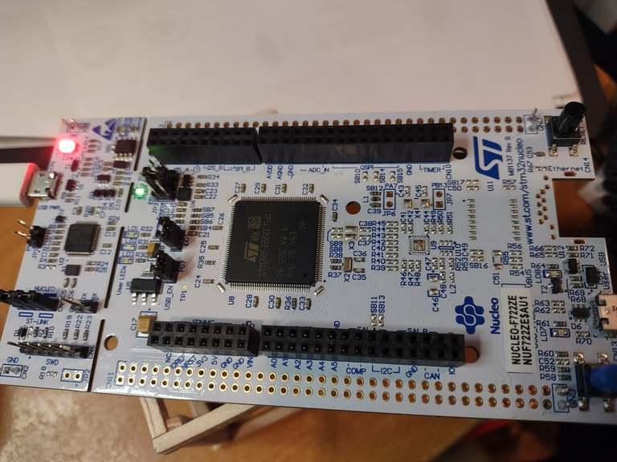

<!--
// ============================================================================
// This file is part of Bifrost
//
// Copyright (c) 2025 Jeff Wandling
// All Rights Reserved.
//
// Licensed under BSD 3-Clause
// Redistribution and use in source and binary forms, with or without
// modification, are permitted under the terms of the BSD 3-Clause license.
// See the LICENSE file for the full text.
// ============================================================================
-->
# C


This directory holds two independent C applications. See
[`../README.md`](../README.md) for how the two language trees relate,
and [`../HARDWARE.md`](../HARDWARE.md) for the boards.

<i>Note: this page assumes your toolchain is already set up. If not, see
[`SETUP.md`](SETUP.md) first -- it covers the one-time install steps,
shared by both projects below. There is also a
[Software Design Document](SOFTWARE.md) here that explains the
architecture of both.</i>

## Three projects, three boards

|  | `f722ze-tiny` | `f767zi` | `samv71-tiny` |
|---|---|---|---|
| Board | NUCLEO-F722ZE (STM32F722ZET6) | NUCLEO-F767ZI (STM32F767ZI) | SAMV71 Xplained Ultra (ATSAMV71Q21B) |
| Internal name | `bifrost` (CMake project `bifrost`) | `bifrost` (CMake project `bifrost`) | `m7` (CMake project `m7`, executable `image.elf`) |
| Console UART | USART3 (ST-Link VCP) | USART3 (ST-Link VCP) | USART1 (on-board EDBG) |
| Vendor BSP | none -- all registers hand-written | none -- all registers hand-written | yes -- CMSIS + Atmel/Microchip SAMV71 DFP (`main/vendor/`) |
| Debug probe | ST-Link (OpenOCD) | ST-Link (OpenOCD) | SEGGER J-Link |
| Status | LCD counter demo + TinyMon console; built/flashed/run on real hardware | LCD counter demo + TinyMon console; builds and links clean against the real toolchain, not yet flashed to physical hardware | complete: TinyMon console, RTBus wire protocol, command dispatch |

`f722ze-tiny` is an LCD-counter demo with an interrupt-driven,
bidirectional TinyMon console over UART -- originally laid as the
foundation for a small ohmmeter application. `f767zi` is the same
application ported to NUCLEO-F767ZI, deliberately keeping the same
HSI-16MHz/no-PLL clock approach rather than bringing up a PLL, so only
the linker script's memory map actually differs (2MB Flash / 512KB RAM
instead of 512KB/256KB) -- see "f767zi" below. `samv71-tiny` is a
from-scratch MIL-1553-style binary packet protocol (`rtbus`) and
command dispatcher, also fronted by its own TinyMon console -- an
unrelated application, not a variant of `f722ze-tiny`. `samv71-tiny` is
also the reference implementation `ada/samv71-tiny` was later ported
from, in this same repo.

# f722ze-tiny (NUCLEO-F722ZE)

This is the C implementation of `bifrost`, the bare-metal firmware
application targeting the NUCLEO-F722ZE -- internally still named
`bifrost` (CMake project `bifrost`, executable `bifrost.elf`); only the
top-level directory was renamed to `f722ze-tiny` for consistency with
`samv71-tiny`'s board-app naming.

## Target Hardware



The hardware chosen is the ST-Micro STM32 Development board, part number [NUCLEO-F722ZE](https://mou.sr/4gYRkFV).

This is fine for the C target specifically -- bare-metal C has no
runtime to speak of, so board choice within the NUCLEO-144/STM32F7
family isn't load-bearing here. NUCLEO-F767ZI also works and is the
preferred board project-wide (required for the Ada target's tasking
work); see [`../HARDWARE.md`](../HARDWARE.md) for why. F722ZE remains
fine to use for this C target, in a pinch or by choice.

Silicon: STM32F722ZET6, Cortex-M7 r1p1

* [Datasheet](https://www.st.com/resource/en/data_brief/nucleo-f207zg.pdf)
* [Processor](https://www.st.com/resource/en/datasheet/stm32f722ic.pdf)
* [Documentation, Schematics, etc.](https://www.st.com/en/microcontrollers-microprocessors/stm32f722ze.html?ecmp=tt9470_gl_link_feb2019&rt=db&id=DB3171)

Local reference copies of the above, plus the LCD component datasheet used by this version's display driver:

* [NUCLEO-144 board/schematics (UM1974)](../docs/datasheet/board/um1974-stm32-nucleo144-boards-mb1137-stmicroelectronics.pdf)
* [MB1137 board reference](../docs/datasheet/board/MB1137.pdf)
* [STM32F72x/F73x reference manual (RM0431)](../docs/datasheet/processor/rm0431-stm32f72xxx-and-stm32f73xxx-advanced-armbased-32bit-mcus-stmicroelectronics.pdf)
* [NHD-0108HZ-FSW-GBW display](../docs/datasheet/display/NHD-0108HZ-FSW-GBW.pdf)

## Software

`main.c` drives an LCD counter demo on a third-party character display
(NHD-0108HZ-FSW-GBW, connected via GPIO) alongside an interrupt-driven,
bidirectional USART3 console (`usart3.c`) running a TinyMon command
dispatcher (`tinymon.c`, `help`/`count`/`license` commands) -- the foundation for
the ohmmeter application this project is building toward. See
[`SOFTWARE.md`](SOFTWARE.md) for the full architecture (super-loop
design, `app`/`behavioral`/`lowlevel`/`interfaces` component roles,
requirements-writing discipline, etc.).

## Build

Toolchain prerequisites: see [`SETUP.md`](SETUP.md).

From `f722ze-tiny/`:

```
$ cd f722ze-tiny
$ bash buildw.sh
```

This configures the project via CMake and builds it with
`arm-none-eabi-gcc`/`arm-none-eabi-g++`, producing `build/bifrost.elf`.
`buildw.sh` is the Windows/git-sdk-64 flavor; `build.sh` is the native-Linux
equivalent. Both support `-c`/`--clean-only` to just remove the build
directory, and `-v`/`--verbose` for verbose `make` output.

## Debugging with GDB

Start `openocd` (see [`SETUP.md`](SETUP.md) if this is your first time --
it needs to be running and connected before gdb can attach):

```
$ export OPENOCD_SCRIPTS=/mingw64/share/openocd/scripts
$ openocd -f interface/stlink.cfg -f target/stm32f7x.cfg -c "adapter speed 2000"
```

Leave `openocd` running as is.

Now we need another `git-sdk-64` window.

If the binary image is present, then you will load it with the debugger
onto the target hardware, set a breakpoint and run the application:

As follows:

```
$ arm-none-eabi-gdb -q build/bifrost.elf -ex "target extended-remote :3333"
```

The output/session would look like this:
Items in **bold** are what you enter during the session.

Below the **commands** entered are `gdb` commands and they are explained
here:

<ul>
<li> <b>list</b> will print the lines of source code at the current
context of the software.  As long as <b>-g</b> flag is given to the
compiler, the debug symbols will be present in the image.
<li> Pressing <b>Enter</b> in <b>gdb</b> simply repeats the last command.
<li> <b>b</b> sets a breakpoint.   There are a number of ways to set break points:
  <ol>
   <li> The line number of the current compilation unit (otherwise known as
  the current module, otherwise known as the file that is in context.)
   <li> The function name <b>b function</b> where <b>function</b> is a function name
    in the software.  <b>gdb</b> has tab-completion so you can search interactively.
   <li> The line number of a compilation unit (file) that is *not in the
  current context* by <b>b filename:linenumber</b>  OR by function name in that
  module by <b>b filename::function</b>.
   <li> The address to break.  This is useful if you're trying to stop, step
  at a certain machine instruction.  <b>b &#42;ADDRESS</b>. If the address was <b>0x2001002</b> then use <b>b &#42;0x2001002</b>.
   <li> To show the next 10 instructions: <b>x/10i $pc</b>
   <li> There are more commands to investigate and print out the assembly
of the image loaded.  Most of the time we're going to debug line by line (of source), but you can also debug at the instruction granularity. See the <b>gdb</b> manual for all of those commands
   </ol>
<li> <b>load</b>  Reads the image file argument and attempts to write it into
the  memory sections defined in the linker file (<b>.ld</b>) for the application.

It reads the ELF file headers (section table + program headers) to know:
For each section (.text, .data, .rodata, etc.),
The Load Memory Address (LMA) - i.e. where in target memory it should go.
Those addresses are fixed by your linker script (.ld).
<pre>
<code>
MEMORY {
  FLASH (rx)  : ORIGIN = 0x08000000, LENGTH = 512K
  RAM   (rwx) : ORIGIN = 0x20000000, LENGTH = 256K
}

.text : { &#42;(.text&#42;) } > FLASH
.data : { &#42;(.data&#42;) } > RAM AT > FLASH
.bss  : { &#42;(.bss&#42;)  } > RAM
.text and .rodata get LMA = 0x08000000 + ... (in Flash).
</code>
</pre>

<b>.data</b> has VMA = RAM (<b>0x2000xxxx</b>), but LMA = Flash (<b>0x0800yyyy</b>).

At load time, GDB writes .text into Flash, and .data's init image into Flash at <b>0x0800yyyy</b>.

<li> <b>c</b>  (Continue) -- the debugger will cause the software to run freely until either a breakpoint is reached or a fault/trap occurs, or some other
error.  If the flow of execution has completed, then this also is a cause for
<b>c</b> to stop progress.  But in embedded systems, it's highly unusual
for the sofware to reach a point where no more execution occurs in the
nominal path.  Embedded software usually runs continually.
<pre>
<code>
main() {

   // ...
   while(1) {
      // ...
      work();
   }

   // never reaches here
}
</code>
</pre>

<li> <b>q</b> quits the debugger.
</ul>

### A Sample Debugging Session

(Captured very early in this project, before the LCD counter demo,
USART3 driver, or TinyMon console existed -- `main.c` here is just a
GPIO blink loop. Kept as a real, unedited transcript rather than
re-captured; the paths shown reflect this project's directory layout
and name at that earlier point in its history.)

<pre>
<code>
$ arm-none-eabi-gdb -q build/bifrost.elf  -ex "target extended-remote :3333"
Reading symbols from build/bifrost.elf...
Remote debugging using :3333
(gdb) <b>load</b>
Loading section .isr&#95;vector, size 0x200 lma 0x8000000
Loading section .text.delay, size 0x24 lma 0x8000200
Loading section .text.main, size 0x4c lma 0x8000224
Loading section .text.&#95;init, size 0xe lma 0x8000270
Loading section .text.&#95;fini, size 0xe lma 0x800027e
Loading section .text.copy&#95;section, size 0x34 lma 0x800028c
Loading section .text.zero&#95;section, size 0x2c lma 0x80002c0
Loading section .text.SystemInit, size 0xe lma 0x80002ec
Loading section .text.Reset&#95;Handler, size 0x50 lma 0x80002fc
Loading section .text.Default&#95;Handler, size 0x8 lma 0x800034c
Loading section .text.&#95;&#95;libc&#95;init&#95;array, size 0x48 lma 0x8000354
Start address 0x080002fc, load size 922
Transfer rate: 1 KB/sec, 83 bytes/write.
(gdb) <b>list</b>
9       #define GPIOB&#95;MODER ((volatile uint32&#95;t&#42;)(GPIOB&#95;BASE + 0x00))
10      #define GPIOB&#95;ODR ((volatile uint32&#95;t&#42;)(GPIOB&#95;BASE + 0x14))
11
12      static void delay(volatile uint32&#95;t count)
13      {
14      while(count--) asm("nop");
15      }
16
17      int main(void)
18      {
(gdb) <b>ENTER</b>
19      &#42;RCC&#95;AHB1ENR |= (1 << 1);
20
21      &#42;GPIOB&#95;MODER &= ~(3UL << (0 &#42; 2));
22      &#42;GPIOB&#95;MODER |=  (1UL << (0 &#42; 2));
23
24      while(1)
25      {
26          &#42;GPIOB&#95;ODR ^= 1;
27          delay(1000000);
28      }
(gdb) <b>b 19</b>
Breakpoint 1 at 0x8000228: file C:/Users/jdw/ohm/OhmMeter/bifrost/app/src/main.c, line 19.
Note: automatically using hardware breakpoints for read-only addresses.
(gdb) info b
Num     Type           Disp Enb Address    What
1       breakpoint     keep y   0x08000228 in main
                                           at C:/Users/jdw/ohm/OhmMeter/bifrost/app/src/main.c:19
(gdb) <b>r</b>
The program being debugged has been started already.
Start it from the beginning? (y or n) <b>y</b>
Starting program: C:\Users\jdw\ohm\OhmMeter\bifrost\build\bifrost.elf

Breakpoint 1, main () at C:/Users/jdw/ohm/OhmMeter/bifrost/app/src/main.c:19
19      &#42;RCC&#95;AHB1ENR |= (1 << 1);
(gdb) <b>q</b>
</code>
</pre>

# f767zi (NUCLEO-F767ZI)

This is the C implementation of `bifrost` ported to the NUCLEO-F767ZI
-- internally still named `bifrost` (CMake project `bifrost`,
executable `bifrost.elf`), same as `f722ze-tiny`; this is a different
top-level directory for the same application, not a different one.

## Target Hardware

STM32F767ZI, Cortex-M7 (same core, different memory map, from the same
STM32F7 family as F722ZE -- see [`../HARDWARE.md`](../HARDWARE.md)).

## Software

Deliberately a minimal port: this target keeps `f722ze-tiny`'s
HSI-16MHz/no-PLL clock approach rather than bringing up a PLL, so
register addresses, the UART baud divisor (`USART3_BRR = 139`, correct
for 115200 at HSI 16MHz), and the delay-loop calibration constants all
carry over from `f722ze-tiny` unchanged. Only `config/stm32f767zi.ld`
actually changes -- `FLASH`/`RAM` lengths updated to this chip's real
2MB/512KB (confirmed in the linked ELF's own map file, not just the
source: `FLASH` length `0x00200000`, `RAM` length `0x00080000`) -- plus
the startup file's name (`startup_stm32f767.c`) and a couple of
now-stale comment references to it, for consistency. Same TinyMon
console as `f722ze-tiny` (`help`/`count`/`license`), same LCD driver,
same delay/UART drivers byte-for-byte.

## Build

Toolchain prerequisites: see [`SETUP.md`](SETUP.md) -- identical to
`f722ze-tiny`, nothing board-specific to install.

From `f767zi/`:

```
$ cd f767zi
$ bash buildw.sh
```

Verified with a real `cmake`/`arm-none-eabi-gcc` build: configures and
links clean, no warnings, producing `build/bifrost.elf` with the
correct `FLASH`/`RAM` lengths in its own map file (checked directly,
not assumed from the linker script source alone).

## Debugging

Same ST-Link/OpenOCD chain as `f722ze-tiny` -- same physical debug
probe, same board family, same stock `target/stm32f7x.cfg`. Not yet
flashed to physical hardware; no GDB session transcript or proof-of-life
capture exists for this port yet (unlike `f722ze-tiny` above).

# samv71-tiny (SAMV71 Xplained Ultra)

This is `samv71-tiny`, the C firmware this session's `ada/samv71-tiny`
was ported from -- internally named `m7` (CMake project `m7`, library
targets `m7_app`/`m7_lowlevel`/`m7_rtbus`/`m7_tinymon`/`m7_startup`,
executable `image.elf`). Its project root is one level deeper than
`f722ze-tiny`'s: the actual `CMakeLists.txt` lives at
`c/samv71-tiny/main/`, not at `c/samv71-tiny/` itself.

## Target Hardware

SAMV71 Xplained Ultra (Microchip/Atmel ATSAMV71Q21B, Cortex-M7) --
completely different vendor and silicon family from the STM32F7 NUCLEO
pair `f722ze-tiny` targets, not a related or interchangeable board.

## Software

A tokenizer/state-machine command dispatcher (`tinymon.c`, stand-in
`cmda`/`cmdb`/`cmdc` commands plus `help`/`license`, same deliberate
minimalism as `f722ze-tiny`'s `help`/`count`/`license`) running over
USART1 -- this board's
on-board EDBG debug UART (PA21/PB4), not a separate ST-Link-style VCP
chip. Underneath the console is `rtbus/` -- a MIL-1553-style binary
packet protocol (frame sync, a CRC-16-checked header, a payload
preamble, and a trailing CRC-32 over the payload), with no counterpart
anywhere in `f722ze-tiny`. Unlike `f722ze-tiny`, this project binds
directly to a real vendor BSP: `main/vendor/` carries CMSIS and the
Atmel/Microchip SAMV71 Device Family Pack as source, pulled into the
build rather than hand-written from the reference manual. See
[`SOFTWARE.md`](SOFTWARE.md) for the full architecture, including a
real exception worth knowing about: this project's `main()` is the one
place in this repo that genuinely uses the super-loop phase structure
`SOFTWARE.md`'s skeleton describes (`GatherInputs`/`Calculate`/
`RenderOutput`/`WaitForCycle`), though most of the individual phase
functions are still empty stubs.

**A real, unfixed bug worth knowing about before you connect a
terminal**: `lowlevel/src/usart1.c`'s baud divisor
(`USART1_BAUD_CD`/`USART1_BAUD_FP`, currently `162`/`6`) was computed
for a 300MHz peripheral clock, but the actual clock tree divides Master
Clock by 3 before it reaches any peripheral (100MHz) -- so the real
baud rate comes out at 115200 / 3 = 38400, not the intended 115200.
**Set your terminal to 38400, not 115200.** This was diagnosed this
session but deliberately not fixed here -- `ada/samv71-tiny`'s port
does not reproduce it (see `ada/README.md`), but this C source still
has the original, uncorrected constants.

## Build

Toolchain prerequisites: see [`SETUP.md`](SETUP.md) (shared with
`f722ze-tiny` above).

From `samv71-tiny/main/` (note: one level deeper than `f722ze-tiny`):

```
$ cd samv71-tiny/main
$ bash build.sh
```

(`buildw.sh` for Windows.) Same CMake-based build as `f722ze-tiny`,
producing `build/image.elf`.

## Debugging

A genuinely different debug chain from `f722ze-tiny`'s OpenOCD/ST-Link
setup: **`setupw.sh` here drives SEGGER J-Link**, not OpenOCD --
`JLinkGDBServer`, device ID `ATSAMV71Q21`. Install the J-Link Software
and Documentation Pack from SEGGER
(https://www.segger.com/downloads/jlink/) -- see
[`SETUP.md`](SETUP.md)'s "Hardware Interface" section. Two windows, two
modes, same shape as `f722ze-tiny`'s workflow:

```
$ bash setupw.sh -s
```

```
$ bash setupw.sh -d -i build/image.elf
```

No GDB session transcript has been captured for this project in this
document (unlike `f722ze-tiny` above) -- verification has been via
real-hardware testing of the command pipeline directly, not a captured
interactive session.

<hr>
Copyright 2025 Jeff Wandling<br>
